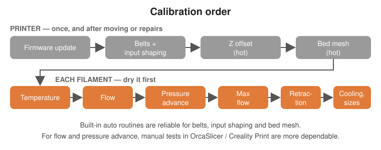
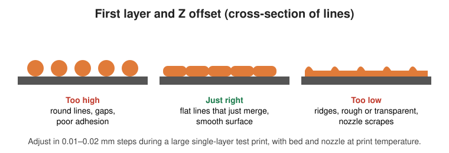
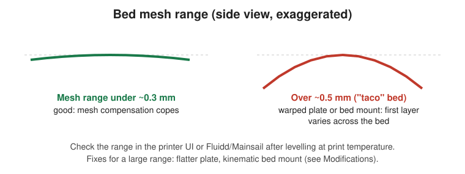
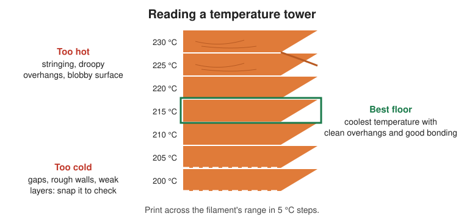
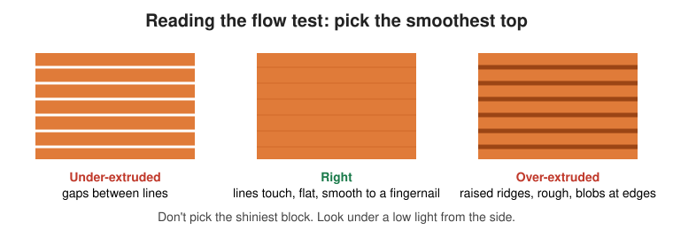
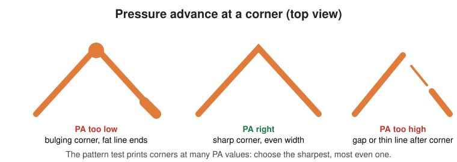
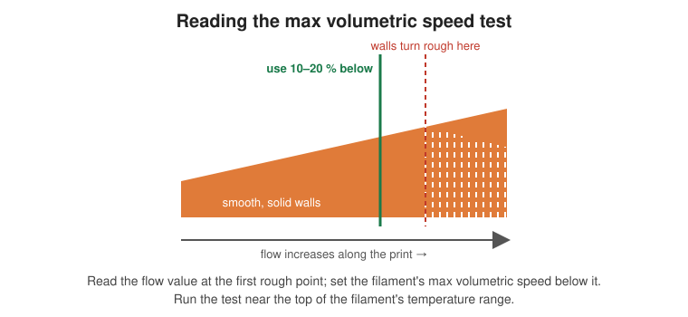
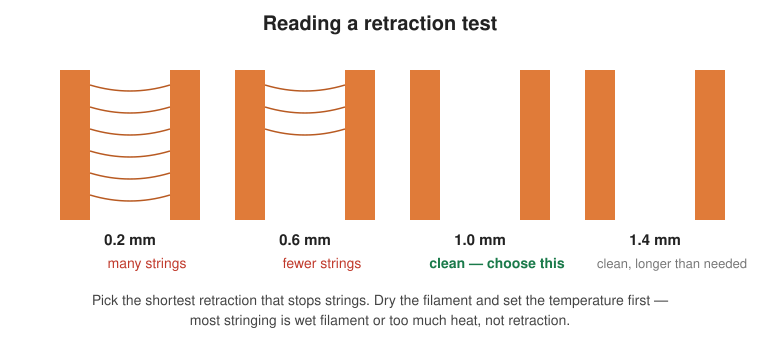
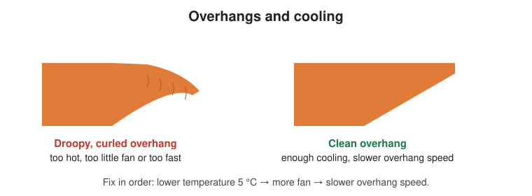
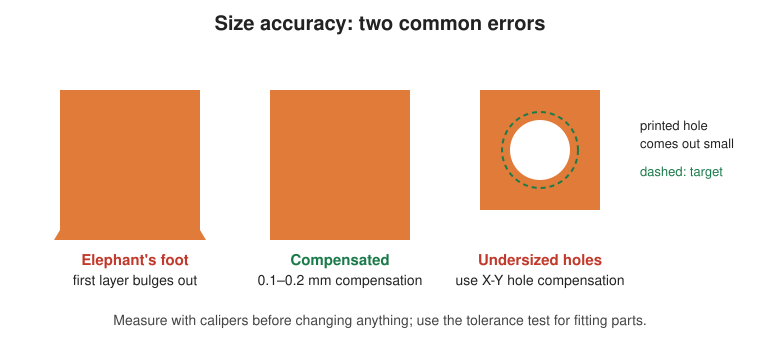

# Calibrating the Creality K2: What Works and What Doesn't

A practical calibration guide for the Creality **K2 Plus** (and K2 / K2 Pro), using the
printer's built-in routines, **Creality Print** and **OrcaSlicer**. Each step says what to do,
what reliably works, and what tends to go wrong.

Settings that build on these results: [Print Settings](print-settings.md).

Changed the hotend or nozzle? See [Ceramic Hotends and Silicon Carbide Nozzles](hotend-and-nozzles.md).
Other modifications: see [what to recalibrate after each mod](modifications.md#what-to-recalibrate-after-each-mod).

## Contents

1. [Order matters](#1-order-matters)
2. [Before any calibration](#2-before-any-calibration)
3. [Printer self-test, belts and input shaping](#3-printer-self-test-belts-and-input-shaping)
4. [Z offset and first layer](#4-z-offset-and-first-layer)
5. [Bed mesh](#5-bed-mesh)
6. [Temperature](#6-temperature)
7. [Flow rate](#7-flow-rate)
8. [Pressure advance](#8-pressure-advance)
9. [Max volumetric speed](#9-max-volumetric-speed)
10. [Retraction](#10-retraction)
11. [Cooling and overhangs](#11-cooling-and-overhangs)
12. [Dimensional accuracy, shrinkage and tolerances](#12-dimensional-accuracy-shrinkage-and-tolerances)
13. [Auto calibration vs manual: summary](#13-auto-calibration-vs-manual-summary)
14. [Recording results](#14-recording-results)
15. [Sources](#15-sources)

---

## 1. Order matters

Each calibration depends on the one before it. Doing them out of order means repeating work.

**Printer (once, and after moving it or changing parts):**
1. Firmware update → 2. Self-test: belts, input shaping → 3. Z offset → 4. Bed mesh

**Each new filament (or brand, or colour that behaves differently):**
5. Temperature → 6. Flow rate → 7. Pressure advance → 8. Max volumetric speed →
9. Retraction → 10. Cooling → 11. Dimensional/tolerance (for functional parts)

Note: OrcaSlicer's own documentation has at times listed **pressure advance before flow**. Both
orders work in practice; if you change one significantly, re-check the other.

## 2. Before any calibration

What works:
- **Latest firmware.** Several Creality Print / CFS problems (e.g. "Y coordinate out of range")
  were fixed by updating the printer firmware.
- **Dry filament.** Wet filament changes flow and pressure advance results and makes every test
  noisy. Dry PETG, TPU, PA and silk/matte PLAs first.
- **Clean nozzle, clean plate.** Wash the plate with warm water and washing-up liquid; wipe with
  IPA between prints. Clean the nozzle and the nozzle-camera window.
- **Hot, soaked printer.** Run calibrations at print temperature after 5–10 minutes of heating —
  results from a cold machine differ.
- **Tight hotend screws and gantry** — loose parts give drifting results that no calibration
  fixes.

What doesn't:
- Calibrating with a damp spool and expecting the numbers to hold once it's dried.
- Calibrating through a worn CFS path or long PTFE route, then printing from a different feed —
  users report PTFE length, CFS roller wear and moisture all change auto-calibrated PA and flow.

## 3. Printer self-test, belts and input shaping

The K2 Plus has built-in routines on the printer screen: self-test, **belt auto-tension**,
**input shaping (resonance)**, and **extrusion servo motor calibration**.

**What works**
- Run the full self-test after unboxing, after moving the printer, and after any mechanical work.
- **Belt auto-tension** keeps the belts consistent; run it before input shaping.
- **Input shaping** removes most ringing. Rerun after moving the printer or changing the
  surface it stands on.
- **Extrusion servo motor calibration** (Creality wiki procedure) if you see extrusion
  inconsistency after a hotend or extruder change.

**What doesn't**
- Input shaping won't fix ringing caused by a wobbly table — put the printer on a solid, heavy
  surface.
- If ringing remains after input shaping, **lower outer wall acceleration** in the slicer rather
  than rerunning the test repeatedly.

## 4. Z offset and first layer

Most first-layer problems on the K2 Plus with stock settings come down to the **Z offset**.

**What works**
- **Heat bed and nozzle to printing temperature first**, then run the levelling/Z routines. A cold
  calibration followed by a hot print changes the first layer.
- **Print a first-layer test** (a large single-layer square) and adjust Z offset in small steps
  (0.01–0.02 mm) on the printer during the print until lines just merge with no gaps and no
  ridges.
- Some users had success setting a **Z offset in the slicer** (Creality Print / Orca machine
  settings) when the printer's offset wasn't applied as expected.
- **Flat, good-quality build plate.** Several users fixed inconsistent first layers by replacing
  a warped plate; others reported first-layer issues that followed the curvature of the mesh.

**What doesn't (or is disputed)**
- Reports conflict on whether changing Z offset on the K2 Plus affects the mesh calculation — if a
  change seems to do nothing, check whether the printer or the slicer value is being used, and
  check for firmware updates.
- Some K2 Pro users found the Z offset wasn't applied during calibration until a macro fix — use
  the forum fix only if you're comfortable editing printer config.
- Repeatedly lowering Z offset to fix poor adhesion: usually the plate is dirty.

## 5. Bed mesh

**What works**
- Auto bed levelling at print temperature with the plate you'll print on.
- Check the mesh range in the printer UI or Fluidd/Mainsail: under ~0.3 mm is good; above ~0.5 mm
  suggests a warped plate or bed.
- Re-mesh if you change plates (smooth vs textured differ in thickness).

**What doesn't**
- Bed mesh only approximates the bed shape — it can't fix mechanical issues (loose hotend, uneven
  gantry). If the mesh "keeps growing" or the nozzle scrapes after calibration, check the hotend
  mounting screws first.

## 6. Temperature

**Tool:** Orca → Calibration → Temperature (tower). Creality Print has the same in its
Calibration menu.

**What works**
- Tower across the filament maker's range in 5 °C steps. Pick the coolest temperature that still
  gives good layer adhesion and a smooth surface — overhangs, bridges and stringing tell you most.
- Use the result at your **quality speeds**. If you print fast, choose the upper end — high flow
  needs more heat.

**What doesn't**
- Choosing on surface look alone: snap the tower by hand to check layer adhesion at the cooler
  floors.
- Using Creality's default temperatures (tuned for speed) for slow, detailed prints — often 5–10 °C
  too hot for quality.

## 7. Flow rate

### Option A — Printer auto-calibration (Creality Print "auto calibration" before a print)

On the K2, ticking calibration when sending a print runs **flow (and PA) calibration** with the
nozzle camera.

**What works**
- Convenient for Creality's own filaments, whose profiles are already close.
- Clean the **nozzle camera** and nozzle before it runs; if the pattern isn't recognised, the
  calibration fails or gives odd results.

**What doesn't**
- It can **over-correct**: one user's flow dropped to 0.81 from 0.95 on Hyper PLA, giving under-
  extrusion. If parts look thin or gappy after auto-calibration, check the stored flow value.
- Results vary with moisture, CFS and PTFE path — repeat runs can differ.
- At least one report of a **nozzle crash during flow calibration** — watch the first run.
- Many users leave auto-calibration **off** once filament profiles are tuned manually.

### Option B — OrcaSlicer flow test

**Tool:** Orca → Calibration → Flow rate → **Pass 1**, then **Pass 2**.

**What works**
- Two-pass method: Pass 1 prints nine blocks with different flow modifiers; pick the smoothest top
  surface (feel it with a fingernail), update the filament flow ratio, then Pass 2 to refine.
- Judge **top surfaces** under raking light.
- Calibrate **temperature first** — flow changes with temperature.

**What doesn't**
- Choosing the shiniest block — choose the one with no gaps and no ridges.
- The newer "YOLO" Archimedean-chords pattern divides opinion; if it's hard to read, use the
  classic two-pass test.
- Calibrating flow with a bad first layer (affects the test squares).

## 8. Pressure advance

Pressure advance (PA) compensates for pressure lag in the nozzle, giving sharp corners and even
lines. Creality's defaults: PLA ~0.04, PETG 0.05–0.10, ABS/ASA 0.03–0.06, TPU 0.3–0.4.

### Options

| Method | Works well | Watch out |
|---|---|---|
| **Printer auto-calibration** | Convenient; fine for Creality filaments | Same sensitivity to moisture/PTFE/CFS as flow; can vary run to run |
| **Orca pattern test** | Fast, easy to read | Needs a good first layer |
| **Orca tower test** | Independent of first layer | Takes longer; harder to read |
| **Orca line test** | Quick | Easy to misjudge |
| **Adaptive pressure advance (Orca)** | Most accurate on high-speed printers — PA varies with speed and acceleration | Several tests needed to build the table; newer feature |

**What works**
- Enable pressure advance in the filament profile and store the value there.
- Re-test when changing nozzle size, filament brand, or temperature significantly.

**What doesn't**
- Over-high PA: gaps after corners and thin starts of lines. Too low: blobby corners, bulging
  seams.
- Pattern test with a poor first layer — use the tower instead.

## 9. Max volumetric speed

**Tool:** Orca → Calibration → Max flowrate. Prints a tapered tower at increasing flow.

**What works**
- Raise nozzle temperature towards the top of the filament's range for this test — melting capacity
  depends on temperature.
- Read where the walls first start to look rough or thin; set MVS **10–20 % below** that point for
  reliable prints.
- Check every PETG profile — a stock CR-PETG profile in one Creality Print version had MVS
  18 mm³/s; 8–12 mm³/s is more typical for PETG.

**What doesn't**
- Using the highest flow you saw once — it fails on long prints, after the hotend heats the
  filament less, or with a different spool.
- For quality prints MVS rarely matters — your outer wall speed is far below the limit.

## 10. Retraction

**Tool:** Orca → Calibration → Retraction test (tower with increasing retraction length).

**What works**
- Start at 0.4 mm and step up 0.1–0.2 mm; pick the shortest length that stops strings.
  Typical K2 results 0.6–1.0 mm.
- **Dry the filament and get temperature right first** — most stringing isn't retraction.
- Wipe on loops and wipe while retracting help hide residual strings.

**What doesn't**
- Long retractions (2 mm+) on a direct-drive extruder — causes clogs and gaps.
- Tuning retraction on a wet spool.

## 11. Cooling and overhangs

**Tools:** Orca overhang and bridge test models (or community models).

**What works**
- PLA: full fan; tune overhang speed. PETG: 40–80 % and test overhangs. ABS/ASA: low fan, warm
  chamber.
- Lower temperature 5 °C before raising fan for droopy overhangs.

**What doesn't**
- Full fan on ABS/ASA: cracks and warping.
- Expecting more cooling to fix bridges sagged by too-high flow — check flow first.

## 12. Dimensional accuracy, shrinkage and tolerances

**What works**
- Print a **calibration cube** (20 mm) or better a larger 100 mm part; measure with calipers in X,
  Y and Z.
- **Shrinkage** in the filament profile for ABS/ASA/PC (often 99.3–99.6 %).
- **X-Y hole compensation** and **X-Y contour compensation** (Orca) for fitting parts — print a
  tolerance test (Orca → Calibration → Tolerance) and adjust.
- **Elephant's foot compensation** (0.1–0.2 mm) for first-layer bulge.

**What doesn't**
- Scaling the whole model or changing steps/mm to fix small (<0.5 %) errors — usually flow, shrink
  or compensation is the real cause.
- Skew correction is a Klipper feature that some users add in start G-code, but it's per-machine
  and needs careful measurement (a skew test print); there's no official K2 procedure. Only do it
  if square parts are measurably out of square.

## 13. Auto calibration vs manual: summary

| Calibration | Built-in auto | Manual (Orca/Creality Print tests) | Recommendation |
|---|---|---|---|
| Belts, input shaping | ✅ Reliable | — | Use auto |
| Bed mesh | ✅ Reliable (at temperature) | — | Use auto, hot |
| Z offset | ⚠️ Usually close | ✅ First-layer test | Auto, then fine-tune by eye |
| Temperature | — | ✅ Tower | Manual |
| Flow | ⚠️ Can over-correct, sensitive | ✅ Two-pass test | Manual for your own filaments |
| Pressure advance | ⚠️ OK for Creality filaments | ✅ Pattern/tower/adaptive | Manual, store in profile |
| Max volumetric speed | — | ✅ Tower | Manual, keep a margin |
| Retraction | — | ✅ Tower | Manual, after drying |
| Dimensions | — | ✅ Cube / tolerance test | Manual for functional parts |

## 14. Recording results

Keep a note per filament (brand, colour, date). Put the values in a saved filament preset in
Creality Print and OrcaSlicer, named for the spool, e.g. "Brand PETG Black @Creality K2 Plus 0.4
nozzle".

| Filament | Dried? | Temp °C | Flow | PA | MVS | Retraction | Fan % | Notes |
|---|---|---|---|---|---|---|---|---|
| *e.g. Brand PETG, black* | | | | | | | | |
| | | | | | | | | |

## 15. Sources

Compiled November 2026 from:

- OrcaSlicer Wiki — [Calibration guide](https://www.orcaslicer.com/wiki/guides/calibration_guide.html), [Flow ratio](https://www.orcaslicer.com/wiki/calibration/flow_ratio_calib), [Pressure advance](https://www.orcaslicer.com/wiki/calibration/pressure_advance_calib.html), [Volumetric speed](https://www.orcaslicer.com/wiki/calibration/volumetric_speed_calib.html)
- Obico — [Comprehensive OrcaSlicer calibration guide](https://www.obico.io/blog/orcaslicer-comprehensive-calibration-guide/), [Flow rate calibration](https://obico.io/blog/flow-rate-calibration-orca-slicer-comprehensive-guide)
- Eolas Prints — [Calibration guide](https://eolasprints.com/blogs/advanced-3d-printing/orca-slicer-flashforge-calibration-guide)
- Stacksheriff — [OrcaSlicer ultimate guide](https://stacksheriff.com/3d-printing/orcaslicer-ultimate-guide/?format=md)
- All3DP — [Orca Slicer calibration explained](https://all3dp.com/2/orca-slicer-calibration-simply-explained/)
- MakerWorld — [Flow calibration discussion](https://www.makerworld.com/en/models/1828284)
- Creality Wiki — [Calibrate extrusion servo motor](https://wiki.creality.com/en/k2-flagship-series/k2-plus/calibrate-extrusion-servo-motor), [Belt auto-tension calibration](https://wiki.creality.com/en/k2-flagship-series/k2-plus/belt-auto-tension-calibration), [Flow calibration failure](https://wiki.creality.com/en/printers-general-documents/AC0516)
- Creality Forum — [Over-extrusion and print quality on K2](https://forum.creality.com/t/over-extrusion-and-print-quality-on-k2/23766), [Calibrating non-Creality filament on the K2](https://forum.creality.com/t/calibration-of-new-non-cr-preconfigured-filament-how-to-for-k2/27472?page=4), [Nozzle scraping, mesh rising](https://forum.creality.com/t/k2-plus-nozzle-scraping-bed-mesh-constantly-going-up-after-calibration-bad-unit/33138/3), [First layer: build plate + Z offset](https://forum.creality.com/t/k2-plus-first-layer-problems-here-s-the-real-fix-build-plate-z-offset/52273), [Real reason for first-layer issues](https://forum.creality.com/t/the-real-reason-of-first-layer-issues-and-a-solution/51921), [K2 Plus first layer issues](https://forum.creality.com/t/if-anyone-wonders-why-the-k2-plus-has-issues-with-the-first-layer/39530), [K2 Pro Z offset not applied](https://forum.creality.com/t/z-offset-not-applied-during-calibration-on-k2-pro-and-how-to-fix-it/53263), [K2 Pro bed levelling](https://forum.creality.com/t/k2-pro-bed-leveling-and-z-offset-is-there-an-easy-way/46925), [Y coordinate out of range](https://forum.creality.com/t/y-coordinate-out-of-range-issue-with-creality-print/52987)
- K2 Plus Helper Script Wiki — [Save Z offset macros](https://sw3defy.github.io/Creality-Helper-Script-Wiki-K2-Plus/helper-script/save-z-offset-macros-k2plus/)
- Klipper — [Bed mesh documentation](https://github.com/KevinOConnor/klipper/blob/46d0c6bdfc346ee6d3e6db704578679cb9fe55c5/docs/Bed_Mesh.md)
- Creality — [K2 Plus recommended filament parameters](https://store.creality.com/uk/blogs/tutorial/k2-plus-filament-parameters-settings)
