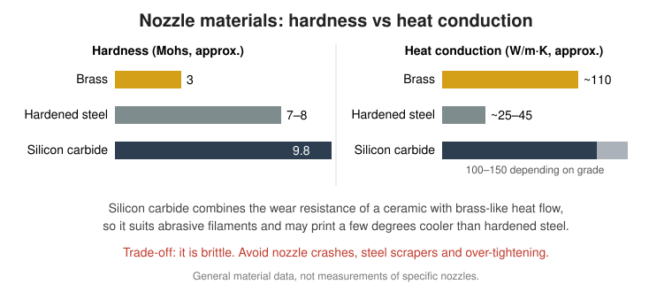
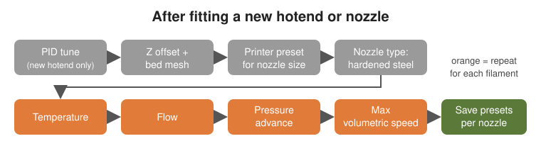

# Ceramic Hotends and Silicon Carbide Nozzles on the K2

What changes when you fit a ceramic-heater hotend or a silicon carbide (SiC) nozzle to a Creality
K2, and which settings to change afterwards.

Related: [Print Settings](print-settings.md) · [Calibration](calibration.md)

## Contents

1. [What the K2 already has](#1-what-the-k2-already-has)
2. [Ceramic heater hotends](#2-ceramic-heater-hotends)
3. [Silicon carbide nozzles](#3-silicon-carbide-nozzles)
4. [Nozzle materials compared](#4-nozzle-materials-compared)
5. [Settings to change](#5-settings-to-change)
6. [Recalibration checklist after a swap](#6-recalibration-checklist-after-a-swap)
7. [Fitting and handling](#7-fitting-and-handling)
8. [Should you upgrade?](#8-should-you-upgrade)
9. [Sources](#9-sources)

---

## 1. What the K2 already has

| | K2 Plus | K2 Pro / K2 |
|---|---|---|
| Heater | **100 W ceramic heater** | ~70 W |
| Max nozzle temperature | 350 °C | 300 °C |
| Nozzle | Integrated nozzle and heat break ("Unicorn"-style quick-swap), hardened-steel tip | Same style |

So the **K2 Plus already uses a ceramic hotend**. A "ceramic hotend kit" for it is either a
like-for-like replacement or an aftermarket design. The K2 Plus and K2/K2 Pro hotends are **not
interchangeable** (different heater power and temperature limits; one owner reports Creality
confirmed this).

The power and temperature figures come from owners' posts and retailer listings; Creality's own
spec pages give the 350 °C / 300 °C limits.

## 2. Ceramic heater hotends

### What a ceramic heater does

A ceramic heater wraps round the melt zone (360°) instead of using a cartridge pushed into a
block. Compared with a cartridge-heated aluminium block:

| Effect | What you'll notice |
|---|---|
| Heats up much faster | Shorter waits; quicker filament changes on the CFS |
| More even heating around the melt zone | More consistent melting at high flow |
| Higher power (100 W on the K2 Plus) | Holds temperature better at high flow — **higher max volumetric speed** |
| Lower thermal mass | Reacts faster to fan changes and flow changes; needs a good PID tune |

For **quality printing at moderate speeds**, a ceramic heater makes little visible difference: the
outer wall runs far below the hotend's limits. It matters most for fast printing and engineering
filaments.

### Options for the K2 Plus

- **Creality K2 Plus ceramic hotend kit** — the stock design as a spare. Some listings give
  300 °C and others 350 °C; check the exact product.
- **Micro Swiss FlowTech for K2 Plus** — all-metal, ceramic heater, rated 350 °C, claimed up to
  50 mm³/s, no firmware changes. K2 Plus only. The flow figure is the maker's claim; I found no
  independent tests.

### Settings after fitting a hotend

- **PID tune** the hotend at your usual printing temperature (printer calibration menu, or
  `PID_CALIBRATE HEATER=extruder TARGET=220` from the Fluidd/Mainsail console if you have root
  access). A new heater with the old PID values can overshoot or oscillate.
- **Z offset and bed mesh** again — the nozzle tip height may differ slightly.
- **Max volumetric speed** test for each filament — a high-flow hotend raises the limit; Creality's
  filament presets (14–23 mm³/s) will under-use it.
- **Temperature tower** — higher flow can let you print a little cooler at the same speed, or
  faster at the same temperature.
- Flow and pressure advance — re-check; a longer melt zone usually needs **slightly higher PA**.

## 3. Silicon carbide nozzles

### What's available

- **Creality × Phaetus Silicon Carbide Nozzle** (0.4 and 0.6 mm), integrated quick-swap nozzle.
  Creality's store lists it for the **K2 Plus and Creality Hi**; a retailer also lists the K2 and
  K2 Pro. Check compatibility for your model before buying.
- Creality also sells a K2/Hi series SiC nozzle in 0.6 mm.

### Maker's claims

| Claim | Value | Notes |
|---|---|---|
| Tip hardness | Mohs 9.8 | Harder than hardened steel (≈ Mohs 7–8) and tungsten carbide (≈ 9) |
| Life | Up to 7 × a hardened-steel nozzle | Maker's figure |
| Flow | Up to 30 mm³/s | Maker's figure |
| Thermal conductivity | "High" | No number given |
| Throat | EndCoat coating, HV3300 | Reduces wear and sticking in the heat break |
| Design | All-metal integrated, "prevents leakage" | Quick swap like the stock nozzle |
| Materials | PLA, PETG, ABS, TPU, and abrasives: carbon fibre, glass fibre, metal-filled, wood, glow-in-the-dark | |

### How SiC changes printing

**Wear:** the main reason to buy one. Abrasive filaments (CF, GF, glow, metal-filled, some matte
and silk PLAs) wear brass quickly and hardened steel slowly; SiC lasts far longer.

**Heat transfer:** silicon carbide conducts heat far better than hardened steel and roughly as
well as brass (general material data: hardened steel ≈ 25–45 W/m·K, brass ≈ 110, SiC ≈ 100–150,
depending on grade). Compared with the stock hardened-steel tip, expect:

- **Same temperature, more flow** — or the same flow at a few degrees cooler.
- Slightly crisper detail at your usual temperature, sometimes slight oozing if the temperature
  stays as high as it was for hardened steel.
- More consistent extrusion at high speed.

**Downsides:**

- **Brittle.** SiC is a ceramic: very hard but can chip or crack from a nozzle crash, a hard
  knock or prying. Steel and brass bend; SiC breaks.
- **Filament build-up.** User reviews of another Phaetus SiC nozzle (Prusa version) report
  filament sticking to the tip and needing more frequent cleaning. Reports for the K2 version
  weren't found.
- **Cost** — several times a standard nozzle.
- **Not much benefit for plain PLA/PETG quality** — the stock hardened-steel tip already handles
  these well.

## 4. Nozzle materials compared

| | Brass | Hardened steel (K2 stock tip) | Silicon carbide | Ruby / tungsten carbide (reference) |
|---|---|---|---|---|
| Wear resistance | Low | Good | **Excellent** | Excellent |
| Heat conduction | High | Low–moderate | **High** | Ruby: low; WC: moderate-high |
| Toughness (resists crashes) | Good | **Best** | Brittle | Ruby: brittle; WC: good |
| Typical temperature compared with stock | ~5 °C lower | Stock | Same to ~5–10 °C lower | — |
| Abrasive filaments | ❌ | ✅ | ✅✅ | ✅✅ |
| Price | £ | ££ | £££ | ££££ |

The temperature offsets are typical starting points; confirm with a temperature tower.

## 5. Settings to change

### Printer / machine profile

| Setting | What to do |
|---|---|
| Printer preset | Select the preset for the **nozzle diameter** you fitted, e.g. "Creality K2 Plus **0.6** nozzle". Don't just change the diameter field on the 0.4 preset — speeds, line widths and layer heights are tuned per nozzle size. |
| Nozzle type | Set to **hardened steel** (Creality Print and Orca don't list SiC). This keeps abrasive-filament warnings working correctly. |
| Max nozzle temperature | Leave at the hotend's rating (350 °C K2 Plus), not the nozzle's. |

### Process (0.6 mm SiC nozzle example)

Many SiC buyers choose **0.6 mm** for carbon fibre. Starting points compared with 0.4 mm:

| Setting | 0.4 mm | 0.6 mm |
|---|---|---|
| Layer height range | 0.08–0.28 mm | 0.16–0.42 mm |
| Quality layer height | 0.12–0.16 mm | 0.20–0.24 mm |
| Line width | 0.42 mm | 0.62–0.68 mm |
| Outer wall speed (quality) | 60–120 mm/s | 60–100 mm/s |
| Wall loops | 3 | 2–3 |
| Detail | Fine text, small parts | Larger parts; small text and sharp corners soften |

A 0.6 mm nozzle shows layer lines no more than a 0.4 mm at the same layer height — the line width
mainly affects detail and strength. For fine-detail models, keep the 0.4 mm nozzle (SiC or stock).

### Filament profiles

| Setting | Change with SiC vs stock hardened-steel tip |
|---|---|
| Nozzle temperature | Run a tower; often 5 °C lower for the same result. CF/GF: Creality advises 280–300 °C for PA-CF/PAHT-CF and a 0.6 mm nozzle. |
| Flow ratio | Re-test; usually within ±2 %. |
| Pressure advance | Re-test; different nozzle bore and geometry change it. Larger nozzle → usually **lower** PA. |
| Max volumetric speed | Re-test; SiC (30 mm³/s claimed) and larger bores raise it. |
| Retraction | Usually unchanged; re-check if stringing changes. |
| Fan | Unchanged. |

### Process settings with a high-flow hotend

You can speed up **inner walls and infill** while keeping the outer wall slow for quality —
the extra flow is used where it doesn't show.

## 6. Recalibration checklist after a swap

1. Fit the nozzle/hotend hot-tightened as the maker instructs (see below).
2. **PID tune** (new hotend) — not needed for a nozzle-only swap.
3. **Z offset** and **bed mesh** at print temperature.
4. Select the right **printer preset** for the nozzle diameter; set nozzle type.
5. Per filament: **temperature tower → flow → pressure advance → max volumetric speed**.
6. Print a test part you know well and compare with an old print.
7. Save new filament presets named for the nozzle, e.g. "Brand PLA @K2 Plus SiC 0.4".

## 7. Fitting and handling

- Swap with the hotend **heated** (follow Creality's nozzle-replacement procedure) so residual
  plastic is soft; power down the heater before touching the hotend if instructed.
- **Don't over-tighten** — integrated nozzles seal on their own design; extra force can crack SiC.
- Clean SiC tips with a **brass** brush or a soft cloth while warm — never steel scrapers.
- Avoid **cold pulls with excessive force**, and avoid nozzle crashes: check Z offset before the
  first print.
- Keep the old nozzle as a spare for ordinary filaments and for comparison.

## 8. Should you upgrade?

| You print… | Recommendation |
|---|---|
| PLA, PETG for quality | Stock hotend and nozzle are fine. Spend the money on dry storage and calibration. |
| Lots of fast, large prints | A high-flow hotend helps throughput; quality depends on outer wall settings anyway. |
| Carbon fibre, glass fibre, glow-in-the-dark, metal-filled | **SiC nozzle**, ideally 0.6 mm. |
| Engineering filaments (PC, PA) at high flow | High-flow ceramic hotend + hardened or SiC nozzle. |

## 9. Sources

Compiled November 2026. Wear and flow figures are manufacturers' claims; thermal and hardness values
for materials are general engineering data, not tests on these products.

- Creality Forum — [Creality × Phaetus silicon carbide nozzle](https://forum.creality.com/t/creality-x-phaetus-silicon-carbide-nozzle/20325)
- Creality Store — [Silicon carbide nozzle for K2 Plus](https://store.creality.com/uk/products/creality-x-phaetus-silicon-carbide-nozzle-0-6mm-k2plus), [K2/Hi series SiC nozzle 0.6 mm](https://store.creality.com/au/products/k2-hi-series-silicon-carbide-nozzle-0-6mm)
- 3DJake — [Phaetus SiC nozzle for K2 Plus/Hi](https://www.3djake.com/phaetus/sic-nozzle-for-the-creality-k2-plus-hi), [Prusa SiC nozzle reviews](https://www.3djake.com/phaetus/nextruder-sic-nozzle-for-prusa), [Creality ceramic hotend K2 Plus](https://www.3djake.com/creality-3d-printers-spare-parts/ceramic-hotend?sai=30848), [Micro Swiss FlowTech for K2 Plus](https://www.3djake.com/micro-swiss/flowtech-hotend-for-creality-k2-plus)
- MatterHackers — [Micro Swiss FlowTech for K2 Plus](https://www.matterhackers.com/store/l/micro-swiss-flowtech-hotend-for-creality-k2-plus/sk/MYQNZHG8)
- 3D Printing Canada — [K2 replacement ceramic hotend](https://3dprintingcanada.com/products/creality-k2-plus-replacement-hotend-assembly)
- All3DP — [Phaetus EndCoat and SiC hotends](https://all3dp.com/4/phaetus-releases-endcoat-and-silicon-carbide-hot-ends-for-major-brand-3d-printers/)
- Creality Forum — [K2 vs K2 Plus hotend swap](https://forum.creality.com/t/k2-combo-hotend-k2-plus-hotend-swap-anyone-tried-success-or-limitations/47808), [K2 Pro with E3D ObXidian settings](https://forum.creality.com/t/best-slicer-settings-for-creality-k2-pro-with-e3d-obxidian-high-flow-nozzle/51085)
- Creality Wiki — [K2 nozzle replacement](https://wiki.creality.com/en/k2-flagship-series/k2/replace-nozzle), [K2 Plus filament parameters](https://wiki.creality.com/en/k2-flagship-series/k2-plus/filament-parameters)
- Creality — [K2 Plus filament parameters (store guide)](https://store.creality.com/uk/blogs/tutorial/k2-plus-filament-parameters-settings)
