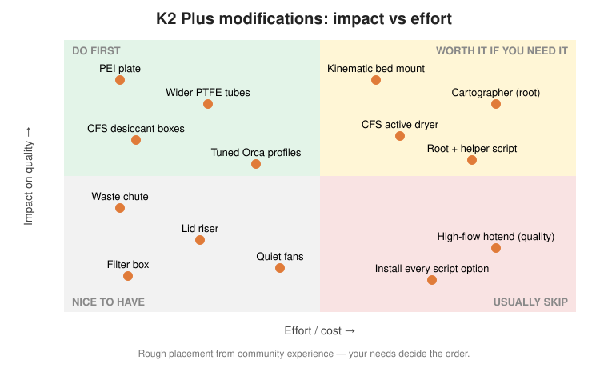

# Suggested Modifications for the Creality K2 Plus

Which upgrades are worth doing on a Creality **K2 Plus** (most apply to the K2 and K2 Pro too), in
three tiers: no root needed, root needed, and major upgrades. Each says what problem it solves.

After any modification, recalibrate what it affects — see
[What to recalibrate after each mod](#what-to-recalibrate-after-each-mod) and
[Calibration](calibration.md).

## Contents

1. [Known issues these mods address](#1-known-issues-these-mods-address)
2. [Tier 1: no root needed](#2-tier-1-no-root-needed)
3. [Tier 2: root and software](#3-tier-2-root-and-software)
4. [Tier 3: major upgrades](#4-tier-3-major-upgrades)
5. [Usually not worth it](#5-usually-not-worth-it)
6. [What to recalibrate after each mod](#what-to-recalibrate-after-each-mod)
7. [Sources](#7-sources)

---

## 1. Known issues these mods address

Community-reported K2 Plus weak points (mostly from a commercial mod guide; treat figures as
indicative):

| Issue | Mods that help |
|---|---|
| "Taco" bed: the plate warps (reported 0.6–0.8 mm diagonally) at 100 °C+ | Kinematic bed mount, better probe, flatter plate |
| Stock probe slow, false triggers with a dirty nozzle | Clean nozzle; Cartographer probe |
| CFS is a passive box with single-use desiccant | Desiccant boxes, active CFS dryer |
| CFS PTFE tubes (1.95 mm bore) add friction with matte, wood and silk PLA | Wider-bore PTFE tubes |
| CFS purge scraps land on the floor | Waste chute |
| Lid PTFE tube rubs the glass lid | Lid riser / tube guide |
| Toolhead fan is the main idle noise | Quiet fan kit |
| Build surface wears and loses adhesion after months of use | PEI plate |
| Stock nozzle wears with CF, GF and metal-filled filaments | Silicon carbide nozzle |
| Chamber is slow to reach 50 °C (reported 30–40 min) | Chamber heat recirculation, lid riser closed |

## 2. Tier 1: no root needed

| Mod | Solves | Cost | Difficulty |
|---|---|---|---|
| **PEI plate** (double-sided, smooth/textured) | Worn surface, adhesion, part release | ££ | Easy |
| **Wider-bore PTFE tubes for the CFS** (e.g. Capricorn or Bambu AMS tubes) | Feed friction, CFS jams with matte/silk/wood | £ | Easy |
| **Desiccant boxes in the CFS** (printable, refillable silica) | CFS humidity | £ | Easy |
| **CFS waste chute** (printed) | Purge scraps on the floor | Free | Easy |
| **Lid riser / vented riser** (printed) | PTFE rubbing the lid; extra clearance; ventilation for PLA | Free | Medium |
| **HEPA + carbon filter box** (printed, uses a standard filter) | Fumes and particles from ABS/ASA | £ | Easy |
| **Quiet toolhead fans** | Noise (vendor claims ~40 % quieter) | ££ | Easy |
| **Hotend silicone sock** (spare) | Heat stability, blobs sticking to the block | £ | Easy, consumable |
| **Tuned OrcaSlicer profiles** | Quality — see [Print Settings](print-settings.md) | Free | Medium |

Notes:
- The vented riser's author suggests **PETG or better** for printed parts near the chamber; PLA
  softens in a heated chamber.
- Vibration-damping feet are popular, but on a fast CoreXY results are mixed — measure ringing
  before and after.

## 3. Tier 2: root and software

**Impact: medium–high · Cost: free · Difficulty: expert · Risk: voids warranty, can brick**

Rooting gives SSH access to the printer's Klipper system so you can add Mainsail/Fluidd, plugins and
macros.

### Enabling root

- On the touchscreen: **Settings → Root account information**, accept the disclaimer, wait about
  30 seconds, press OK.
- SSH as `root`. The default password is published online — **change it immediately with
  `passwd`**, especially if the printer is on a shared network.
- **A factory reset turns root off and deletes everything installed with the helper script**; it
  must be re-enabled and reinstalled from scratch.

### Options

| Project | Provides | Status / cautions |
|---|---|---|
| **Creality Helper Script for K2 Plus** (sw3defy) | Install menu: Moonraker extensions, Fluidd, Mainsail, fan control and useful macros, save-Z-offset macros, M600 filament change, **KAMP** adaptive meshing and purging, improved input-shaper calibration, timelapse, camera support, HelixScreen, OctoEverywhere, Mobileraker, Entware, git backup, SimplyPrint, CFS | Maintained. Its maintenance branch **deliberately blocks some installers** (Moonraker extensions, fan control, KAMP, timelapse, improved shapers) while they're checked — don't install everything; follow its Safe Update Audit and back up files off the printer first |
| **k2-improvements** (jamincollins) | Updated Fluidd and Moonraker, Entware, Cartographer support, axis twist compensation, SCREWS_TILT_CALCULATE, START_PRINT / MESH_IF_NEEDED macros | **Archived (read-only) since August 2025.** Not compatible with Creality's **auto-calibration** |
| **Mainsail-K2 / Fluidd-K2** | Modern web interfaces | Used with the above |
| **OctoEverywhere** | Remote access, AI failure detection | Needs root (or the helper script) |

The Guilouz helper script for the K1 series does **not** support the K2.

**Before rooting:** back up `printer.cfg` and your saved settings; note your Z offset, PA and
calibration values; keep Creality's USB recovery image to hand.

## 4. Tier 3: major upgrades

| Mod | Solves | Cost | Difficulty | Needs root |
|---|---|---|---|---|
| **Kinematic 3-point bed mount** | "Taco" bed warp from the stock 4-point clamp | ££ | Hard | No |
| **Cartographer 3D probe** | Slow, unreliable stock probing; fast dense mesh (25 × 25 in under a minute, per the guide) | £££ | Hard | **Yes** |
| **CFS active dryer** (e.g. Space Pi Double based mod) | Wet filament in the CFS; heated CFS chamber | £££ | Expert | No |
| **Micro Swiss FlowTech hotend** | Flow ~30 → claimed 50 mm³/s; ceramic heater, 350 °C | £££ | Medium | No |
| **Silicon carbide nozzle** | Wear from abrasive filaments | ££ | Easy | No |
| **Chamber heat recirculation** | Slow chamber heat-up for ABS/ASA | Free | Hard | No |

Hotend and nozzle details, and the settings changes they need, are in
[Ceramic Hotends and Silicon Carbide Nozzles](hotend-and-nozzles.md). The stock silicone sock
doesn't fit the FlowTech hotend.

## 5. Usually not worth it

- **A high-flow hotend for quality printing** — the outer wall runs far below the stock limit; it
  only helps throughput.
- **Rooting just for the interface** if you're happy with Creality Print and the screen — it adds
  maintenance and warranty risk.
- **Installing every helper-script option** — the maintainers advise against it.
- **Printed parts in PLA** inside or near the heated chamber.

## What to recalibrate after each mod

| Modification | Recalibrate |
|---|---|
| PEI plate | Bed mesh, Z offset (first-layer test) |
| Kinematic bed mount | Bed mesh, Z offset; check mesh range improves |
| Cartographer probe | Probe calibration, Z offset, mesh; Creality auto-calibration no longer used |
| Root / helper script / k2-improvements | Check saved Z offset and PA still apply; re-run input shaping if a new shaper tool is installed |
| PTFE tubes / CFS dryer | Flow and PA (feed path and moisture change them) |
| Hotend or nozzle | See [the hotend guide](hotend-and-nozzles.md#6-recalibration-checklist-after-a-swap) |
| Quiet fans | Overhang/bridge test if airflow changed; PID if the hotend fan changed |
| Feet / base | Input shaping |

## 7. Sources

Compiled November 2026. Prices, issue figures and mod lists come largely from a commercial guide and
community projects; check each project's current status before installing.

- Printer Hub — [Best Creality K2 mods: 22 upgrades](https://printer-hub.com/posts/creality-k2-best-mods), [K2 known issues](https://printer-hub.com/posts/creality-k2-known-issues), [K2 Plus known issues](https://printer-hub.com/posts/creality-k2-plus-known-issues)
- sw3defy — [Creality Helper Script Wiki for K2 Plus](https://sw3defy.github.io/Creality-Helper-Script-Wiki-K2-Plus/), [Install menu](https://sw3defy.github.io/Creality-Helper-Script-Wiki-K2-Plus/helper-script/install-menu/), [Install and update rooted firmware](https://sw3defy.github.io/Creality-Helper-Script-Wiki-K2-Plus/firmwares/install-and-update-rooted-firmware-k2plus/)
- Creality Forum — [K2 Plus Helper Script Wiki](https://forum.creality.com/t/creality-k2-plus-helper-script-wiki/51766)
- jamincollins — [k2-improvements (archived)](https://github.com/jamincollins/k2-improvements)
- MakerWorld — [K2 Plus CFS riser, ventilation and storage](https://makerworld.com/en/models/858044-k2-plus-cfs-riser-ventilation-and-storage), [K2 Plus vented riser](https://makerworld.com/en/models/2193395-k2-plus-vented-riser), [K2 Plus vent](https://makerworld.com/zh/models/2268385-k2-plus-vent)
- Printables — [K2 Plus CFS heated chamber (Space Pi Double)](https://printables.com/model/1127714-k2-plus-cfs-mod-heated-chamber-space-pi-double/comments), [K2 Plus chamber recirculator and waste chute](https://www.printables.com/model/1480570-k2-plus-chamber-recirculator-waste-chute-combo), [K2-tagged models incl. HEPA/carbon filter box](https://www.printables.com/search/models?q=tag:k2)
- Creality Wiki — [K2 Plus user manual and troubleshooting](https://wiki.creality.com/en/k2-flagship-series/k2-plus)
- Micro Swiss FlowTech for K2 Plus — [3DJake](https://www.3djake.com/micro-swiss/flowtech-hotend-for-creality-k2-plus)
