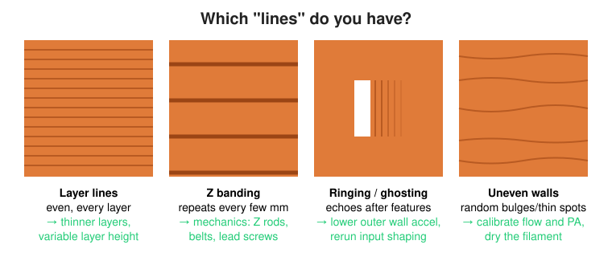
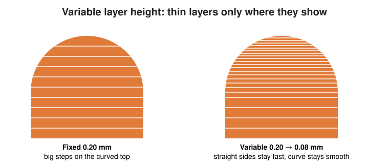
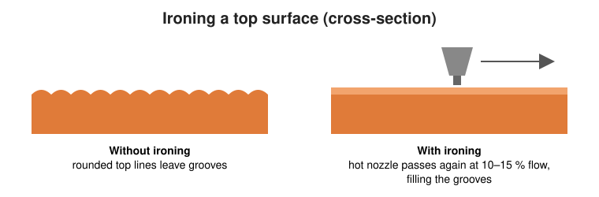
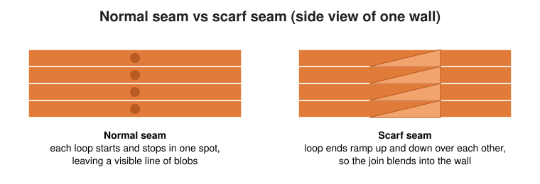
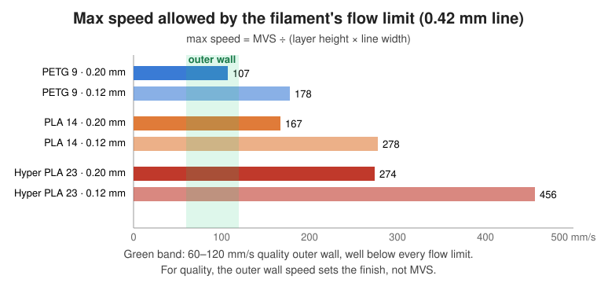

# Print Settings for Quality on the Creality K2

Suggested settings for a Creality **K2 Plus** (most of it applies to the K2 and K2 Pro) with a
0.4 mm nozzle, sliced in **Creality Print** or **OrcaSlicer**. The goal is a clean surface with
minimal layer lines, rather than the fastest print.

Creality Print is built on the same code base as OrcaSlicer, so almost every setting below has
the same name in both. Where they differ, both are given.

Calibrate first: settings only work as well as the printer and filament are tuned. See
[Calibration](calibration.md).

## Contents

1. [The printer and its limits](#1-the-printer-and-its-limits)
2. [Which slicer for what](#2-which-slicer-for-what)
3. [Quality profile at a glance](#3-quality-profile-at-a-glance)
4. [Reducing layer lines](#4-reducing-layer-lines)
5. [Smooth top surfaces](#5-smooth-top-surfaces)
6. [Seams](#6-seams)
7. [Temperatures by filament](#7-temperatures-by-filament)
8. [Speeds and volumetric flow](#8-speeds-and-volumetric-flow)
9. [Cooling](#9-cooling)
10. [Retraction and stringing](#10-retraction-and-stringing)
11. [Building quality presets](#11-building-quality-presets)
12. [Smoothing after printing](#12-smoothing-after-printing)
13. [Quick troubleshooting](#13-quick-troubleshooting)
14. [Sources](#14-sources)

---

## 1. The printer and its limits

| | K2 Plus | K2 Pro | K2 |
|---|---|---|---|
| Max speed (rated) | 600 mm/s | 600 mm/s | 600 mm/s |
| Typical print speed (Creality) | 300 mm/s | 300 mm/s | 300 mm/s |
| Max acceleration | 30,000 mm/s² | 20,000 mm/s² | 20,000 mm/s² |
| Max nozzle temperature | 350 °C | 300 °C | 300 °C |
| Max bed temperature | 120 °C | 110 °C | 100 °C |
| Heated chamber | Active, up to 60 °C | Active, up to 60 °C | None |

The rated maximums are for speed tests. **Good surface quality comes from the outer wall being
slower and gentler** than the machine can go.

Creality notes the chamber may not reach temperature when the room is below 15 °C on 110 V
mains.

## 2. Which slicer for what

| | Creality Print | OrcaSlicer |
|---|---|---|
| CFS multi-colour, filament mapping, cloud/LAN sending | ✅ Best supported | ⚠️ Works with the K2 Plus profile, fewer CFS features |
| Calibration tests | ✅ Calibration menu (inherited from Orca) | ✅ Most complete, documented in the Orca wiki |
| Fine tuning, newest features (scarf seams, adaptive PA) | ✅ Most | ✅ Usually first |
| Creality filament profiles (Hyper PLA, CR-PETG…) | ✅ Built in, 40+ | ✅ Built-in K2 Plus profiles |

Practical approach: **calibrate in OrcaSlicer** (or Creality Print's calibration menu), copy the
values into your filament profiles, and **print multi-colour jobs from Creality Print**. Keep the
printer firmware up to date — older firmware has had problems with Creality Print's CFS start
G-code.

## 3. Quality profile at a glance

Start from **"0.20mm High Quality @Creality K2 Plus 0.4 nozzle"** (or Orca's equivalent) and
change:

| Setting (Orca / Creality Print) | Standard | **Quality** | **Fine detail** |
|---|---|---|---|
| Layer height | 0.20 mm | **0.12–0.16 mm** | **0.08–0.10 mm** |
| First layer height | 0.20 mm | 0.20–0.24 mm | 0.20 mm |
| Line width (outer wall) | 0.42 mm | 0.40–0.42 mm | 0.40 mm |
| Wall loops | 2 | **3** | 3–4 |
| Wall generator | Classic | **Arachne** | Arachne |
| Wall order | Inner/outer | **Inner/outer/inner** with scarf seams, otherwise inner/outer | Inner/outer |
| Precise outer wall | Off | **On** | On |
| Outer wall speed | 200 mm/s | **60–120 mm/s** | 40–80 mm/s |
| Inner wall speed | 300 mm/s | 150–200 mm/s | 100–150 mm/s |
| Outer wall acceleration | 5,000+ | **2,000–4,000 mm/s²** | 1,000–2,000 mm/s² |
| Top surface speed | 200 mm/s | 80–120 mm/s | 60 mm/s |
| Top shell layers | 5 | 6–7 (at 0.12 mm) | 8–10 |
| Top surface pattern | Monotonic line | Monotonic line | Monotonic line |
| Ironing | Off | **Top surfaces** | Top surfaces |
| Seam | Aligned | **Aligned or back + scarf** | Same |
| Infill | 15% grid | 15–20% **gyroid** | 15% gyroid |

These are starting points from Orca and printer-vendor guidance and community practice, not
Creality-published numbers. Print a test piece with your filament and adjust.

## 4. Reducing layer lines

First, look at what kind of lines you have:




| What you see | Cause | Fix |
|---|---|---|
| Even, fine horizontal ridges everywhere | Layer height | Lower layer height; adaptive / variable layer height |
| Ridges that repeat at a regular interval (every few mm) | Z axis / Z banding, bed mesh, mechanical | Check Z rods/belts, lead screw cleanliness; not a slicer setting |
| Ripples or "echoes" after corners and holes | **Ringing** (vibration) | Lower **outer wall acceleration**, rerun input shaping; lowering layer height won't help |
| Random bulging or thin layers | Flow and pressure advance not tuned, wet filament | [Calibrate](calibration.md); dry filament |
| Wavy pattern on smooth curves | Wall order / speed changes | Even out outer wall speed; reduce "slow down for overhangs" effect |
| Visible lines only on one side | Bed mesh or gantry skew | Check mechanics and mesh |

### Settings that help most

1. **Lower layer height** — 0.12 mm reduces visible lines a lot; below 0.08 mm returns diminish
   and time balloons.
2. **Adaptive or variable layer height** — Orca and Creality Print can thin the layers only on
   curved and sloped areas (e.g. 0.08 mm) and keep straight sides thicker. Use **Smooth** in the
   variable layer height tool to avoid sudden steps that create a visible line.
   Note: organic tree supports don't work with variable layer height.
3. **Slow, gentle outer wall** — lower outer wall speed and outer wall acceleration; keep the
   speed consistent (avoid big speed jumps between features).
4. **Precise outer wall** — improves wall spacing and layer consistency.
5. **Arachne wall generator** — varies line width to fill thin features evenly.
6. **Calibrated flow and pressure advance** — inconsistent extrusion looks like layer lines.
7. **Dry filament** — wet filament gives rough walls and bubbles; dry PETG and TPU every time.
8. **Model orientation** — lay the most important surface flat on the bed or vertical; layer
   lines are least visible on vertical walls and most visible on shallow slopes.



### Hide them instead

- **Fuzzy skin** (outer wall only) gives a textured finish that hides lines and seams — good for
  handles and enclosures.
- **Matte or silk filaments** hide or soften lines compared with glossy PLA.
- **Textured PEI plate** for a textured bottom surface.

## 5. Smooth top surfaces

- **Ironing** — top surfaces only (`ironing_type: top`). Starting values: ironing flow **10–15 %**,
  ironing spacing **0.10–0.15 mm**, ironing speed **30–60 mm/s** (slower than the top surface
  speed). Too much flow leaves ridges; too little leaves visible lines.


- **Monotonic** top surface pattern; **more top layers** at small layer heights (aim for at least
  0.8–1.0 mm of top shell).
- **Top surface speed** around 80–120 mm/s.
- Ironing adds time and works best on large flat tops; on curved tops it does nothing.

## 6. Seams

- **Seam position:** "Aligned" or "Back" puts the seam in one predictable place; "Random" spreads
  it but leaves bumps all over.
- **Scarf joint seams** (`seam_slope_type`): ramps the start and end of each loop to hide the
  seam. Use **conditional scarf joint** so it's only used where it helps, a slower scarf speed
 , and **inner/outer/inner** wall order for best results.


- **Seam gap** and **wipe on loops** reduce the blob where a loop closes.
- Use the **seam painting** tool to put seams on a hidden edge.

## 7. Temperatures by filament

Creality's published K2 Plus parameters (store guide dated December 2025). "Chamber" is the
cavity temperature. Max volumetric speed (MVS) is the flow limit in mm³/s.

| Filament | Nozzle °C | Bed °C | Chamber °C | Fan min/max % | MVS mm³/s | Pressure advance | Flow ratio |
|---|---|---|---|---|---|---|---|
| Generic PLA | 220 | 50 | 35 | 100/100 | 14 | 0.04 | 0.95 |
| CR-PLA | 220 | 50 | 35 | 100/100 | 18 | 0.04 | 0.95 |
| PLA+ (EN PLA+) | 220 | 50 | 35 | 100/100 | 14 | 0.04 | 0.95 |
| Hyper PLA | 220 | 50 | 35 | 100/100 | 23 | 0.04 | 0.95 |
| Hyper PLA-CF | 220 | 50 | 35 | 100/100 | 23 | 0.04 | 0.95 |
| Generic PETG | 240 | 70 | 35 | 40/80 | 9 | 0.10 | 0.95 |
| CR-PETG | 240 | 70 | 35 | 40/80 | 12 | 0.07 | 0.95 |
| Hyper PETG | 240 | 70 | 35 | 40/80 | 23 | 0.05 | 0.98 |
| Generic ABS | 260 | 100 | 50 | 10/60 | 16 | 0.06 | 0.95 |
| CR-ABS | 260 | 100 | 60 | 10/60 | 18 | 0.04 | 0.95 |
| Hyper ABS | 260 | 80 | 50 | 10/60 | 23 | 0.03 | 0.95 |
| Generic ASA | 260 | 90 | 50 | 10/70 | 14 | 0.04 | 0.95 |
| HP ASA | 260 | 90 | 50 | 10/40 | 14 | 0.04 | 0.95 |
| Generic PC | 260 | 110 | 50 | 10/60 | 18 | 0.03 | 0.95 |
| Generic TPU | 220 | 40 | 35 | 100/100 | 2 | 0.30 | 1.00 |
| HP-TPU | 220 | 40 | 35 | 100/100 | 3 | 0.40 | 1.00 |
| Carbon-fibre (PA-CF, PAHT-CF, PET-CF) | 280–300 | — | 50 (PAHT-CF) | — | — | — | — |

### How to use these numbers

- They're **defaults for high-speed printing**. For quality at slower speeds you can usually go
  **5–10 °C cooler** (e.g. PLA 205–215 °C, PETG 230–240 °C), which gives crisper detail, better
  overhangs and less stringing. Find the best value with a temperature tower.
- **Third-party filament:** start from the maker's range on the spool, then calibrate.
- **PLA and PETG:** no chamber heating. On long PLA prints keep the top lid open or ajar to avoid
  heat creep and soft, wobbly walls (community advice; Creality doesn't specify this).
- **ABS, ASA, PC, PA:** chamber heating 50–60 °C, **top cover and front door closed**. These
  warp and crack in cold air.
- **TPU:** don't feed it through the CFS or the long PTFE tube; feed directly. Creality says
  filaments softer than 85A are too soft.
- **Carbon fibre:** hardened nozzle, **0.6 mm recommended** (no smaller than 0.4 mm), 280–300 °C,
  clean the nozzle before and after.
- **Dry** PETG, TPU, PA, silk and matte PLAs before and during printing.

## 8. Speeds and volumetric flow

Every speed is ultimately limited by how much plastic the hotend can melt:

```
volumetric flow (mm³/s) = layer height × line width × speed
max speed (mm/s)        = MVS ÷ (layer height × line width)
```

| Filament MVS | 0.12 mm × 0.42 mm | 0.20 mm × 0.42 mm |
|---|---|---|
| 9 mm³/s (generic PETG) | 178 mm/s | 107 mm/s |
| 14 mm³/s (generic PLA) | 278 mm/s | 167 mm/s |
| 23 mm³/s (Hyper PLA) | 456 mm/s | 274 mm/s |



The slicer caps every feature at the filament's MVS automatically, so set MVS correctly in the
filament profile (see [Calibration](calibration.md#9-max-volumetric-speed)) and treat the speed
settings as the quality limit:

- **Outer wall:** 60–120 mm/s for quality. This is the setting you see.
- **Inner walls, infill:** can stay fast; they don't show.
- **Small perimeters / overhangs:** let the slicer slow them down.
- **Acceleration matters as much as speed.** Outer wall 2,000–4,000 mm/s²; inner walls and infill
  can use more.
- One community report flags a stock CR-PETG profile in Creality Print 6.0 with MVS 18 mm³/s,
  where 8–12 is more typical for PETG. Check MVS on any PETG profile.

## 9. Cooling

- **PLA:** 100 % part fan after the first few layers; minimum layer time 4–6 s so small layers
  cool.
- **PETG:** 40–80 %; too much fan weakens layer bonding, too little gives droopy overhangs and
  stringing. A slow-down layer time of about 8 s suits small parts.
- **ABS/ASA/PC:** 10–60 %, keep the chamber warm; use more fan only for overhangs and bridges.
- **Auxiliary/side fan:** helpful for PLA overhangs, turn off for ABS/ASA to avoid warping.

## 10. Retraction and stringing

Creality doesn't publish K2 retraction values. Starting points for the direct-drive extruder:

| Filament | Retraction length | Retraction speed |
|---|---|---|
| PLA | 0.6–0.8 mm | 30–40 mm/s |
| PETG | 0.8–1.0 mm | 30–40 mm/s |
| ABS/ASA | 0.6–0.8 mm | 30–40 mm/s |
| TPU | 0–0.5 mm | 20 mm/s |

Tune with the retraction test. Stringing more often comes from **wet filament or too-high
temperature** than from retraction — dry the spool and drop 5 °C before raising retraction.

## 11. Building quality presets

Rather than editing the built-in presets, save your own copies:

1. Select **"0.20mm High Quality @Creality K2 Plus 0.4 nozzle"** (or your printer's equivalent)
   and save it under a new name for each layer height you use, e.g. "0.12mm Quality PLA" and
   "0.16mm Quality PLA".
2. Apply the [quality settings](#3-quality-profile-at-a-glance): layer height, Arachne, precise
   outer wall, outer wall speed and acceleration, ironing on top surfaces, scarf seams.
3. For PETG, start from the same "High Quality" base rather than "Standard" so outer wall speed
   and acceleration begin lower; add 4 walls, 5 bottom layers, conditional scarf seams at about
   60 % speed, staggered inner seams and wipe on loops.
4. Save a **filament** preset per spool type with your calibrated temperature, flow ratio,
   pressure advance, MVS and slow-down layer time (see [Calibration](calibration.md)).
5. Give presets clear, searchable names; the same names work in Creality Print and OrcaSlicer.

## 12. Smoothing after printing

When the slicer has done what it can:

- **Sanding:** wet-sand PLA (dry sanding heats and smears it), 220 → 400 → 600+ grit.
- **Filler primer** cycles to remove remaining lines before painting.
- **Epoxy coating** (XTC-3D) for a glossy, smooth shell.
- **Vapour smoothing** only works on ABS/ASA (acetone) — not on PLA or PETG.

The **model-painting** repository has full guides on preparing and painting PLA and PETG prints
(`docs/painting-by-material.md`) and on clear top coats (`docs/clear-coats.md`).

## 13. Quick troubleshooting

| Problem | First things to try |
|---|---|
| Visible layer lines | 0.12 mm layers, slower outer wall, calibrate flow/PA, dry filament |
| Ringing/ghosting | Outer wall acceleration down, rerun input shaping, check belts |
| Seam blobs/zits | Scarf seams, seam gap, wipe on loops, calibrate PA |
| Rough top surface | Ironing, more top layers, calibrate flow |
| Stringing | Dry filament, lower temperature 5 °C, then retraction |
| Droopy overhangs | More cooling, lower temperature, slower overhang speed |
| Warping (ABS/ASA) | Chamber 50–60 °C, door and lid closed, brim, clean plate |
| Under-extrusion at speed | Lower MVS in filament profile, raise temperature |
| First-layer problems | See [Calibration](calibration.md#4-z-offset-and-first-layer) |

## 14. Sources

Compiled November 2026 from:

- Creality — [K2 series buying guide](https://www.creality.com/blog/which-to-buy-k2-series-3d-printers), [K2 Plus vs K2 Pro vs K2](https://store.creality.com/blogs/buying-guides/creality-k2-plus-vs-k2-pro-vs-k2), [K2 Plus product page](https://www.creality.com/products/creality-k2-plus-cfs-combo)
- Creality — [K2 Plus recommended filament parameters](https://store.creality.com/uk/blogs/tutorial/k2-plus-filament-parameters-settings) (temperature table)
- Creality Wiki — [K2 Plus filament parameters](https://wiki.creality.com/en/k2-flagship-series/k2-plus/filament-parameters), [CFS supported filaments](https://wiki.creality.com/en/cfs-2/supported-filaments-precautions)
- 3D Printing Industry — [K2 and K2 Pro specifications](https://3dprintingindustry.com/news/creality-launches-its-new-k2-and-k2-pro-desktop-3d-printers-technical-specifications-and-pricing-243390/)
- 3D Mag — [K2 Pro vs K2 Plus](https://www.3dmag.com/3d-printers-comparison/creality-k2-pro-vs-k2-plus/)
- Harktech — [Best slicer for the K2 Plus](https://harktech.co.uk/help/best-slicer-creality-k2-plus)
- K2 Plus Helper Script Wiki — [Slicers](https://sw3defy.github.io/Creality-Helper-Script-Wiki-K2-Plus/slicers/)
- Creality Forum — [Guide to creating quality print settings](https://forum.creality.com/t/guide-to-creating-quality-print-settings/22433), [My print settings](https://forum.creality.com/t/my-print-settings-for-nicer-faster-and-more-hasslefree-prints/29769), [K2 Plus variable print quality](https://forum.creality.com/t/k2-plus-variable-print-quality/52543), [Y-coordinate out of range](https://forum.creality.com/t/y-coordinate-out-of-range-issue-with-creality-print/52987)
- OrcaSlicer Wiki — [Acceleration](https://www.orcaslicer.com/wiki/print_settings/speed/speed_settings_acceleration), [Advanced speed](https://www.orcaslicer.com/wiki/print%5Fsettings/speed/speed_settings_advanced.html), [Max volumetric speed](https://github.com/SoftFever/OrcaSlicer/wiki/Max-Volumetric-Speed)
- SimplyPrint — [OrcaSlicer settings reference](https://simplyprint.io/slicer/orcaslicer.md)
- Printables — [Scarf seams guide](https://printables.com/model/783313-better-seams-an-orca-slicer-guide-to-using-scarf-s)
- Obico — [Adaptive and variable layer height](https://www.obico.io/blog/orca-slicer-adaptive-and-variable-layer-height-guide-smoother-3d-prints/)
- QIDI — [Reducing visible layer lines](https://qidi3d.com/blogs/guides/how-to-reduce-visible-layer-lines-in-3d-printing)
- Nerdbot — [OrcaSlicer features](https://nerdbot.com/2025/11/26/top-7-orca-slicer-features-every-3d-artist-should-use/)
